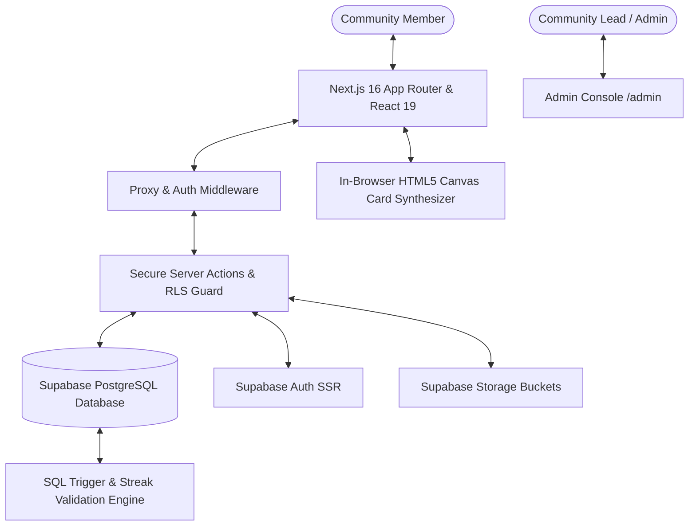

# Community Developer Hub — Architecture & System Design

## 1. System Overview
The **Community Developer Hub** is a purpose-built software showcase, collaboration marketplace, and developer portfolio platform for technology communities. It combines project showcasing, technical team recruitment, verifiable peer evaluations, auditable contribution streaks, and promotional social card generation into a cohesive, zero-cost architecture.

---

## 2. Technology Stack & Zero-Cost Model

| Component | Technology | Free-Tier Allocation |
|---|---|---|
| **Frontend & SSR** | Next.js 16 (App Router, Turbopack, React 19) | Vercel Hobby ($0 / ₹0) |
| **Database & Auth** | PostgreSQL 15+ & Supabase Auth | Supabase Free ($0 / ₹0) |
| **Styling & UI** | Tailwind CSS v4, Lucide React, Next-Themes | Open Source ($0) |
| **Social Media Graphics** | HTML5 Canvas Client-Side Engine | 100% In-Browser ($0) |
| **Type Safety** | TypeScript 5 (Strict Mode) | Local ($0) |

---

## 3. Database Schema Entities & Relationships

The database architecture is normalized with explicit foreign keys, indexes, cascades, and Row Level Security (RLS) policies:

1. **`profiles`**: Developer profiles containing bio, department, skills offered/needed, availability, social links, current streak, longest streak, and total points.
2. **`user_roles`**: Role-based access control (`member`, `moderator`, `lead`, `admin`, `super_admin`).
3. **`projects`**: Showcase projects with title, slug, tagline, markdown description, category, cover image, status, likes, bookmarks, and average 5-dimension rating.
4. **`technologies` & `project_technologies`**: Standardized technologies and relation mapping.
5. **`project_media`**: Screenshots and architecture diagrams.
6. **`project_members`**: Active project team roster with roles (Lead, Contributor, Frontend, Backend, etc.).
7. **`collaboration_opportunities`**: Open roles posted by project creators with required skills and time commitments.
8. **`collaboration_requests`**: Structured member applications with experience notes and portfolio links.
9. **`project_tasks`**: Lightweight Kanban tasks (To Do, In Progress, Under Review, Completed).
10. **`project_updates`**: Technical project changelogs and milestone announcements.
11. **`project_milestones`**: Target dates and completion status.
12. **`project_ratings`**: Multi-dimensional reviews (Technical, Innovation, Design, Documentation, Practical usefulness).
13. **`contributions` & `streak_records`**: Verifiable qualifying action ledger and anti-gaming streak calculation records.
14. **`points_ledger`**: Auditable points transaction history.
15. **`achievements` & `user_achievements`**: Automated badges and unlock timestamps.
16. **`challenges` & `challenge_submissions`**: Community competitions, sprint guidelines, and submissions.
17. **`events` & `event_registrations`**: Hackathons, workshops, and attendee rosters.
18. **`notifications`**: User notifications with read/unread tracking.
19. **`announcements`**: Broadcast messages with pinned flags.
20. **`project_nominations` & `featured_projects`**: Community Spotlight nomination and editorial approval pipeline.
21. **`reports` & `moderation_actions`**: Abuse reporting and moderator action logging.
22. **`admin_audit_logs`**: Tamper-evident admin action auditing.

---

## 4. Anti-Gaming Streak Engine

Unlike platforms that award streaks for superficial page visits, this engine enforces strict validity:
- **Only meaningful actions qualify**:
  1. `project_create`: Publishing a new project (+50 pts)
  2. `project_complete`: Finishing an in-progress project (+100 pts)
  3. `project_update`: Writing a genuine technical update (+15 pts)
  4. `substantive_review`: Submitting a 40+ character peer evaluation (+20 pts)
  5. `task_completed`: Finishing an assigned workspace task (+10 pts)
  6. `challenge_submission`: Submitting an approved challenge entry (+40 pts)
  7. `accepted_contribution`: Being accepted into a project team (+30 pts)
- **Same-Day Uniqueness**: Multiple actions on the same calendar day update total points but **never** produce duplicate streak days.
- **Consecutive Calendar Tracking**: Missing more than 24 hours from the preceding contribution day resets current streak to 1 while preserving the user's historical `longest_streak`.

---

## 5. Security & Row Level Security (RLS) Guardrails

- **No Browser Service Role Key**: Privileged database mutations occur exclusively via secure server actions or PostgreSQL triggers.
- **Explicit RLS Policies**: Every table has RLS enabled with separate rules for SELECT, INSERT, UPDATE, and DELETE.
- **Self-Rating Prevention**: A database constraint and server action guard prevent project creators from reviewing their own projects.
- **Ownership Verification**: Team removal, task edits, and project updates verify that the active authenticated session matches the creator or assigned collaborator.
